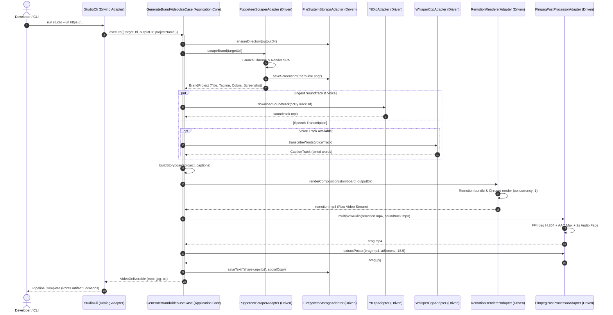

# Brand Video Studio — Architecture & Technical Specifications

> **Hexagonal Architecture (Ports & Adapters) Specification for Autonomous Brand Video Generation**  
> *Targeted at core contributors, system architects, and platform developers.*

---

## 1. Architectural Philosophy

Brand Video Studio is designed around **Hexagonal Architecture** (also known as *Ports and Adapters*), formulated by Alistair Cockburn. The primary architectural objective is **strict domain isolation**:

1. **Zero External Monorepo Coupling**: Brand Video Studio is an independent, sovereign application. It does not import, depend upon, or mutate the target repositories for which it generates video deliverables.
2. **Infrastructure Independence**: The core business logic (analyzing a brand, constructing a storyboard, scheduling scenes, timing captions, and packaging deliverables) does not know whether videos are rendered via Remotion, Hyperframes, or cloud encoders; nor does it care whether audio is transcribed via local C++ binaries (`whisper.cpp`) or external cloud APIs.
3. **Pluggable Adapters**: All external tools (Puppeteer, FFmpeg, Remotion, yt-dlp, whisper.cpp, FileSystem) are isolated behind outbound interface ports, enabling unit testing with pure mocks and plug-and-play adapter swaps.

```
                   ┌─────────────────────────────────────────────────────────┐
                   │                     Driving Adapter                     │
                   │               (StudioCli / API Controller)              │
                   └────────────────────────────┬────────────────────────────┘
                                                │ invokes
                                                ▼
┌───────────────────────────────────────────────────────────────────────────────────────────┐
│ APPLICATION CORE                                                                          │
│                                                                                           │
│  ┌─────────────────────────┐         ┌─────────────────────────┐                          │
│  │      Inbound Port       │         │        Use Case         │                          │
│  │  (IGenerateBrandVideo)  │────────▶│ (GenerateBrandVideoUC)  │                          │
│  └─────────────────────────┘         └────────────┬────────────┘                          │
│                                                   │ orchestrates                          │
│                                                   ▼                                       │
│  ┌─────────────────────────────────────────────────────────────────────────────────────┐  │
│  │ DOMAIN MODEL                                                                        │  │
│  │                                                                                     │  │
│  │  • Entities:       BrandProject, VideoDeliverable                                   │  │
│  │  • Value Objects:  Scene, Storyboard, CaptionTrack, WordToken                       │  │
│  │  • Domain Rules:   Frame timing, scene ordering, aspect ratios, branding validation │  │
│  └─────────────────────────────────────────────────────────────────────────────────────┘  │
│                                                   │                                       │
│                                                   ▼ delegates                             │
│  ┌─────────────────────────────────────────────────────────────────────────────────────┐  │
│  │ Outbound Ports (Abstract Interfaces)                                                │  │
│  │                                                                                     │  │
│  │  • IWebScraperPort           • IAudioIntelligencePort    • IStoragePort             │  │
│  │  • IVideoRendererPort        • IMediaIngestionPort       • IVideoPostProcessorPort  │  │
│  └─────────────────────────────────────────────────────────────────────────────────────┘  │
└───────────────────────────────────────────┬───────────────────────────────────────────────┘
                                            │ implemented by
                                            ▼
┌───────────────────────────────────────────────────────────────────────────────────────────┐
│ DRIVEN ADAPTERS (Infrastructure Layer)                                                    │
│                                                                                           │
│  ┌─────────────────────┐  ┌─────────────────────┐  ┌─────────────────────┐                │
│  │  PuppeteerScraper   │  │   RemotionRenderer  │  │   WhisperCppSpeech  │                │
│  │  (Chrome Headless)  │  │   (React 19 Engine) │  │   (Quantized GGUF)  │                │
│  └─────────────────────┘  └─────────────────────┘  └─────────────────────┘                │
│  ┌─────────────────────┐  ┌─────────────────────┐  ┌─────────────────────┐                │
│  │    YtDlpIngestion   │  │  FfmpegPostProcess  │  │  FileSystemStorage  │                │
│  │    (CLI Wrapper)    │  │  (H.264+AAC Muxer)  │  │  (Disk Isolation)   │                │
│  └─────────────────────┘  └─────────────────────┘  └─────────────────────┘                │
└───────────────────────────────────────────────────────────────────────────────────────────┘
```

---

## 2. Directory Layout & Layer Mapping

The codebase enforces strict separation of concerns through its directory structure under `src/`:

```text
src/
├── domain/                         # Pure enterprise business rules (Zero dependencies)
│   ├── entities/
│   │   ├── BrandProject.ts         # Target project aggregate root
│   │   └── VideoDeliverable.ts     # Deliverable bundle entity (video, poster, audio, copy)
│   └── value-objects/
│       ├── CaptionTrack.ts         # Timed word-by-word token array
│       ├── Scene.ts                # Scene definition (frame ranges, transitions, props)
│       └── Storyboard.ts           # Ordered sequence of scenes totaling target duration
│
├── application/                    # Application business rules
│   ├── ports/
│   │   ├── inbound/
│   │   │   └── IGenerateBrandVideo.ts       # Driving port interface
│   │   └── outbound/                        # Driven port interfaces
│   │       ├── IAudioIntelligencePort.ts    # Speech recognition & transcription
│   │       ├── IMediaIngestionPort.ts       # Audio & media downloading
│   │       ├── IStoragePort.ts              # Artifact filesystem management
│   │       ├── IVideoPostProcessorPort.ts   # Remuxing, encoding, poster extraction
│   │       ├── IVideoRendererPort.ts        # Motion canvas frame rendering
│   │       └── IWebScraperPort.ts           # SPA metadata & viewport screenshotting
│   └── use-cases/
│       └── GenerateBrandVideoUseCase.ts     # Core pipeline orchestrator
│
├── adapters/                       # External world integrations
│   ├── driving/                    # Inbound entry points
│   │   └── cli/
│   │       └── StudioCli.ts                 # CLI parser & command dispatcher
│   └── driven/                     # Outbound implementations
│       ├── media/
│       │   └── YtDlpAdapter.ts              # yt-dlp media downloader
│       ├── postprocessor/
│       │   └── FfmpegPostProcessorAdapter.ts # FFmpeg muxer & poster extractor
│       ├── renderer/
│       │   ├── HyperframesRendererAdapter.ts # Lightweight HTML/Canvas renderer
│       │   └── RemotionRendererAdapter.ts    # React 19 Remotion renderer
│       ├── scraper/
│       │   └── PuppeteerScraperAdapter.ts   # Headless Chrome SPA DOM scraper
│       ├── speech/
│       │   └── WhisperCppAdapter.ts         # whisper.cpp C++ CLI transcriber
│       └── storage/
│           └── FileSystemStorageAdapter.ts  # Node.js fs/promises storage
│
├── composition/                    # Remotion React 19 motion graphics canvas
│   ├── Root.tsx                    # Composition registration & configuration
│   ├── index.ts                    # Remotion bundler entrypoint
│   ├── BrandVideoComposition.tsx   # 5-Scene narrative video composition
│   └── components/
│       └── KineticCaptions.tsx     # Whisper-synced word-by-word animated captions
│
└── container.ts                    # Composition Root (Dependency Injection wiring)
```

---

## 3. Core Domain Entities & Value Objects

### 3.1 `BrandProject` (Entity)
Represents the target application or brand undergoing video production.
```typescript
export interface BrandProjectProps {
  id: string;
  name: string;
  url: string;
  tagline: string;
  colors: {
    background: string;
    foreground: string;
    accent: string;
    secondaryAccent?: string;
  };
  screenshotPath?: string;
}
```
**Responsibilities:**
- Validates brand integrity (valid URLs, accessible hex color formats).
- Associates scraped visual assets with brand identity tokens.

### 3.2 `Storyboard` & `Scene` (Value Objects)
A `Storyboard` is an immutable sequence of `Scene` objects that mathematically divide the total composition duration (e.g., 600 frames @ 30fps = 20.0 seconds).
```typescript
export interface Scene {
  id: string;
  name: string;
  startFrame: number;
  durationInFrames: number;
  type: 'hook' | 'reveal' | 'feature' | 'playground' | 'outro';
  props: Record<string, unknown>;
}
```

### 3.3 `VideoDeliverable` (Entity)
Encapsulates all final customer-facing deliverables generated during a pipeline execution:
```typescript
export class VideoDeliverable {
  constructor(
    public readonly projectId: string,
    public readonly videoPath: string,       // Final H.264 + AAC MP4
    public readonly posterPath: string,      // Frame 0 / settled state JPEG
    public readonly audioPath?: string,      // Royalty-free background soundtrack
    public readonly captionsPath?: string,   // Word-level SRT/JSON caption track
    public readonly socialCopyPath?: string  // Viral launch social copy markdown
  ) {}
}
```

---

## 4. Pipeline Execution Sequence Flow

The following sequence diagram details the end-to-end execution of `GenerateBrandVideoUseCase`:



---

## 5. Architectural Decision Records (ADRs)

### ADR-001: Independent Studio Repository vs Monorepo Coupling
- **Status:** Accepted
- **Context:** The GoF Design Patterns application repo is an educational monorepo containing React 19, an Express API server, and shared schemas. We needed a video marketing generator without bloating the monorepo with video engines, FFmpeg binaries, or large media assets.
- **Decision:** Create `brand-video-studio` as an independent repository under `H:\Projects\brand-video-studio`. The studio targets any website via public URL or local dev server URL, emitting videos into an isolated `output/` directory.
- **Consequences:** Client projects remain 100% clean and uncoupled. One studio instance can produce videos for any number of different web applications.

### ADR-002: Remotion (React 19) over Raw FFmpeg Filtergraphs
- **Status:** Accepted
- **Context:** Programmatic video can be built via low-level FFmpeg complex filtergraphs (`-filter_complex`) or React component trees.
- **Decision:** Adopt Remotion 4 with React 19 as the primary visual composition engine.
- **Consequences:** Allows motion graphics to be built using standard React declarative code, CSS flexbox, spring physics, and typography. Developers can scrub through compositions in real-time in a web browser using Remotion Studio (`pnpm dev`).

### ADR-003: whisper.cpp over Python PyTorch Whisper
- **Status:** Accepted
- **Context:** We require word-level caption timing for kinetic typography. Standard OpenAI Whisper requires Python 3.10+, PyTorch (~2.5 GB), CUDA drivers, and >=4 GB RAM. The host machine is an Intel Core i3 with only ~1.2 GB of available RAM.
- **Decision:** Integrate `whisper.cpp` (high-performance C++ implementation) using the 4-bit/quantized `ggml-tiny.en.bin` model (77.7 MB).
- **Consequences:** Speech transcription executes in <2 seconds with memory consumption capped under 150 MB RAM and zero Python dependencies.

### ADR-004: Hardware-Conscious Single-Worker Rendering (`--concurrency 1`)
- **Status:** Accepted
- **Context:** Remotion defaults to spawning $N$ headless Chromium render instances matching CPU thread count (4 workers). On a 2-core / 4-thread machine with 1.2 GB available RAM, 4 concurrent Chrome instances trigger severe memory swapping and crash Node.js.
- **Decision:** Force `--concurrency 1` on all CLI and programmatic renders.
- **Consequences:** Stable, deterministic 1080p rendering with maximum memory ceiling below 1.1 GB. Total render time for a 20-second 600-frame video is ~3.5 minutes on low-power hardware.

### ADR-005: Dual-Layer Audio Handling
- **Status:** Accepted
- **Context:** Videos require background audio with volume automation and seamless web streaming compatibility.
- **Decision:** Implement audio at two complementary layers:
  1. *Composition Layer:* Remotion native `<Audio />` with frame-interpolated volume curves for real-time previewing in Remotion Studio.
  2. *Post-Processor Layer:* FFmpeg multiplexing (`-c:a aac -b:a 192k -movflags +faststart`) to ensure strict container synchronization and Frame 0 poster baking.

---

## 6. Dependency Injection & Testability

All dependencies are wired in [`src/container.ts`](file:///H:/Projects/brand-video-studio/src/container.ts) using constructor injection:

```typescript
export class ServiceContainer {
  private static instance: ServiceContainer;

  public readonly scraper: IWebScraperPort;
  public readonly renderer: IVideoRendererPort;
  public readonly speech: IAudioIntelligencePort;
  public readonly media: IMediaIngestionPort;
  public readonly postProcessor: IVideoPostProcessorPort;
  public readonly storage: IStoragePort;
  public readonly generateBrandVideoUseCase: GenerateBrandVideoUseCase;

  constructor() {
    this.storage = new FileSystemStorageAdapter();
    this.scraper = new PuppeteerScraperAdapter();
    this.renderer = new RemotionRendererAdapter();
    this.speech = new WhisperCppAdapter();
    this.media = new YtDlpAdapter();
    this.postProcessor = new FfmpegPostProcessorAdapter();

    this.generateBrandVideoUseCase = new GenerateBrandVideoUseCase(
      this.scraper,
      this.renderer,
      this.speech,
      this.media,
      this.postProcessor,
      this.storage
    );
  }
}
```

### Unit Testing Strategy
Because each outbound port is an interface, unit tests in `src/test/` can test `GenerateBrandVideoUseCase` by substituting in-memory mock adapters without invoking Chrome, FFmpeg, or downloading files:

```typescript
const mockScraper: IWebScraperPort = {
  scrapeBrand: async (url) => ({
    name: 'Mock Project',
    tagline: 'Mock Tagline',
    colors: { background: '#000', foreground: '#fff', accent: '#f59e0b' }
  })
};
```

